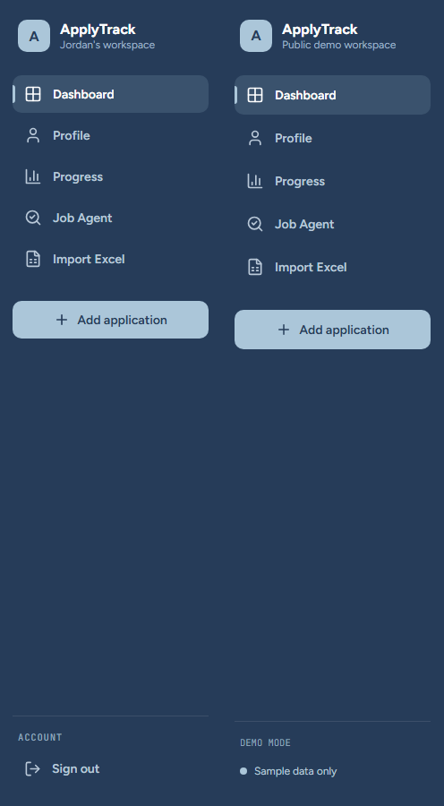
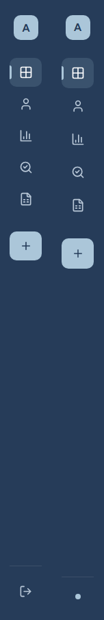
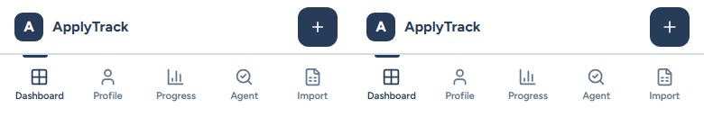

# UI-01: Design Foundations and Navigation Shell

Status: implemented and locally verified; awaiting ChatGPT review and user visual acceptance. No merge or deployment is authorized here.

## Canonical Reference

- Design: `UI_update`, commit `8bc43e40a20ab333a4437f8d60a067a3b7338915`,
  `new_design/ApplyTrack Redesign.html`.
- Implementation baseline: RF-15 squash merge
  `f5e73157ff78e3b1127bfdc9bdfbc6f99877f2b6` on `main`.
- The bundled artifact was decoded only into ignored `tmp/ui2-01.local/reference/`
  for inspection. Its runtime, fake account actions, analytics, data and mutation
  logic are not part of the implementation. `UI_update` remains unchanged.

## Foundations

`src/index.css` owns reusable tokens and the five approved colors:

| Color | Value | Role |
| --- | --- | --- |
| Midnight Blue | `#263C59` | Navigation, primary actions, headings, Offer |
| Steel Blue | `#617E9E` | Focus, supporting accents, Interview |
| Powder Blue | `#ABC6D9` | Sidebar mark/action, active accent, Applied |
| Mist Lilac | `#BCBBD5` | Rejected and future supporting treatments |
| Frost White | `#E8EDF0` | Application canvas |

Neutral surfaces/borders and accessible status foreground/background pairs follow
the artifact. Semantic success/error/warning tokens remain available for real
feedback; this phase does not recolor every legacy business component.

Figtree is the UI family; JetBrains Mono is limited to metadata such as the
sidebar footer label. The exact Latin WOFF2 assets embedded in the reference are
self-hosted under `src/assets/fonts/`, with official SIL Open Font Licenses.
No third-party font requests, new package dependencies or system installation.
Unsupported glyphs use system fallbacks. Spacing, type sizes, radii, focus rings,
surface/text hierarchy, status pairs and motion all have CSS tokens.

`AppLayout.css` provides reusable `ui-button` primary/secondary/ghost treatments.
Existing page-specific controls can adopt these in their own migration phase.

## Responsive Shell

| CSS viewport | Layout |
| --- | --- |
| `width >= 1040px` | 248px Midnight sidebar, labels, Add application, account footer |
| `640px <= width < 1040px` | 76px icon rail, full accessible names, hover/keyboard tooltips, Add and Sign Out |
| `width < 640px` | 60px top bar, Add action, five-item 70px bottom navigation |

The range queries meet exactly, including fractional widths. Content padding
reserves fixed-header/footer space and safe-area insets. Short-height sidebars
scroll to retain account access, with native tooltip fallback when scrolling.
All shell controls are at least 44px; mobile Profile Sign Out remains 48px.

The existing primary order is preserved: Dashboard, Profile, Progress, Job Agent,
Import Excel. Mobile display labels retain Agent/Import. Add routes to the real
existing form, and remains hidden on forms as before. Browser back/forward,
navigation callbacks and form save lifecycles are unchanged.

Sign Out is visible in the desktop/sidebar rail, or in Profile on mobile, never
both. Demo retains all local simulated workflows and does not pretend to sign
out of a personal account. The artifact's fake sign-out toast was not copied.

## Motion and CSS Ownership

- Press 140ms; hover/color 200ms; navigation 320ms; content entrance 420ms.
- Easing: `cubic-bezier(.2,.7,.2,1)`; transforms/opacity drive entrance/movement.
- A presentation-only previous navigation index allows the existing route-owned
  `AppLayout` instances to animate the active indicator across mounts. No route,
  session, data or form state was moved. Reduced motion skips that animation.
- Global reduced-motion rules also disable CSS motion and smooth scrolling.
- The 800ms chart token is reserved; module-specific reveals are not implemented.

All shell rules now live in `src/components/AppLayout.css`. A structured PostCSS
cleanup removed 154 obsolete shell selectors from `App.css` and `theme.css`,
splitting mixed selector lists instead of dropping unrelated rules. Non-shell
declarations, media scopes and ordering were independently compared with main.
Two Job Agent header text colors are the only page-style exceptions: they use
semantic foreground tokens so the new Frost canvas does not introduce a contrast
regression. No page layout or business component was migrated for that correction.
The remaining page rules retain their existing breakpoints until those modules
are migrated; shell breakpoints have one owner rather than appended overrides.

## Visual Verification

Reference and implementation were rendered at 1440/768/390px, 1x pixel density
and 900px height. The prototype's presentation frame/device bezel was removed
only in the capture browser to align CSS viewport sizes. The reference file is
unchanged. Comparisons below show reference left, implementation right.

The first comparison found a 6px identity-height offset; explicit line heights
corrected it. Palette, Figtree, brand, widths, mobile bars and active treatments
were visually inspected side by side, not inferred from test success.
Intentional differences: 44px accessible desktop/rail controls versus the
prototype's 42px rows; real/Demo identity/account semantics; zero letter tracking.
The resulting 2px row increments also shift the Add action 10px downward.
The main Dashboard cards, page headings, forms, charts and queue remain legacy
content, not a claim of full-page prototype fidelity.

## Verification

| Check | Local result |
| --- | --- |
| `npm run lint` | Passed |
| `npm test` | 204 passed |
| `npm run test:audit` (logic/real Edge handler harness) | 30 passed |
| Full Chromium functional suite | 214 passed |
| Focused Firefox navigation/responsive/Profile suite | 40 passed |
| Focused WebKit navigation/responsive/Profile suite, one worker | 40 passed |
| `npm run test:auth-ui` | 12 passed |
| `npm run build` | Passed; both font assets included |
| `git diff --check` | Passed |

Browser commands use `npm run test:audit-ui -- --project chromium` for the full
suite, or filter `navigation-shell.spec.js responsive-navigation.spec.js
demo-profile.spec.js` with `--project firefox` / `--project webkit --workers 1`.
The focused suite has 40 cases per browser. The new accessibility checks are
independent per viewport and wait for the loaded destination heading and unique
shell, rather than inspecting a retained Suspense tree/loading placeholder.
No assertions were removed or skipped to accommodate transitions.

Optional parallel WebKit sweeps encountered seven initial `page.goto`/`load`
timeouts before product assertions. A fresh, single-worker run of all 40 cases
passed (4.4 minutes). Use the default single-worker configuration for repeatable
Windows WebKit verification; the cause of those parallel load stalls is not
established. Earlier test-only failures (integer viewport assumptions, lazy-page
readiness and a combined accessibility time budget) were corrected and rerun.

Focused coverage checks all five destinations, sign-out and Add behavior, active
indicators, keyboard focus/tooltips, reduced motion, shell accessibility, history,
short-height access, resize/session continuity and fractional breakpoints.
All browser requests use the existing synthetic backend or Public Demo; no
production operations or Supabase configuration changes are performed.

Firefox on this Windows display exposes fractional media-query widths despite
rounded `innerWidth` values (a requested 640px measured about 639.983px; 1040px
about 1039.883px). Tests assert the actual, mutually exclusive CSS layout mode
and record the measured width rather than assuming integer viewport rounding.

Local-only full-page screenshots, traces and geometry are under
`tmp/ui2-01.local/` and ignored `node_modules/.cache/ui2-01/`; committed shell
comparisons above are the review evidence. Browser profiles/output use the latter
to avoid Vite watching temporary Firefox lock/trace files.
Safe-area CSS is inspected/emulated, not physical-device certification.
The whole-page observational audit still reports two legacy issues outside the
shell: Progress references a conditionally absent Calendar panel with
`aria-controls` (UI-03), and Job Agent's waiting-state labels use the existing
`#758195` on white (UI-04). Shell/header Axe assertions pass; this is not a claim
of whole-application accessibility certification.

## Deferred Scope

1. UI-02: Dashboard cards, Board/List, application cards/detail/form layouts,
   module typography, controls and corresponding legacy styles.
2. UI-03: Progress/Calendar visualization styling and chart motion.
3. UI-04: Job Agent surfaces, chips, queue controls and module motion.
4. UI-05: Profile, Import, authentication and remaining page presentation.

Existing CRUD, selection, concurrency, rejection dates, salary interpretation,
import, analytics and auth contracts remain authoritative. No database migration,
Edge Function change, production operation, manual deployment or automatic merge.
General Refinement cleanup remains deferred during the approved UI 2.0 sequence.
